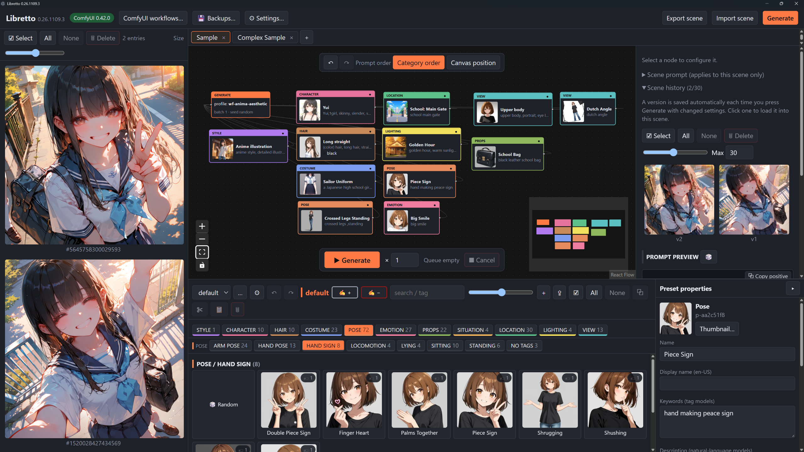
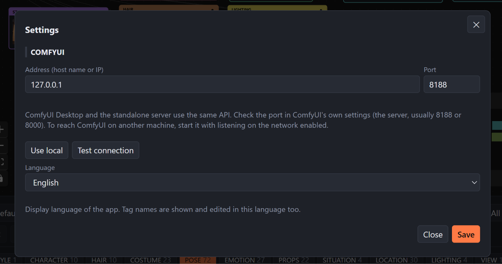
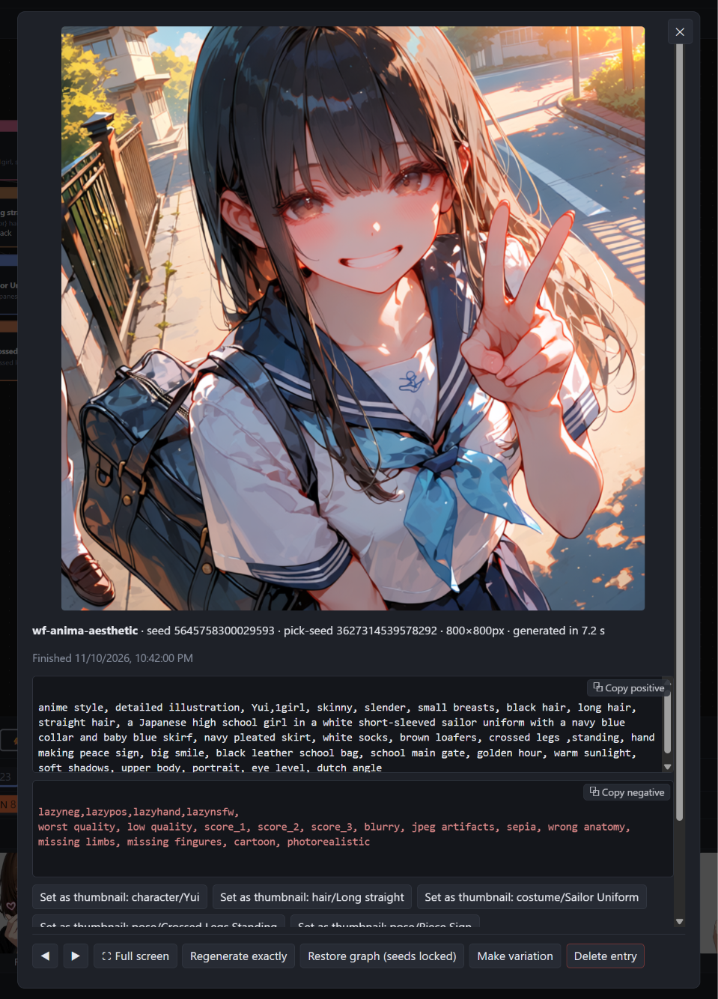

# Libretto

[English version](README.md)

## はじめに

Libretto は、ComfyUI 向けのノードベースの**プロンプト生成ツール**です。
キャラクター、衣装、ポーズ、場所、照明などの再利用可能なプリセットを
ノードとして配置し、視覚的にプロンプトを組み立ててシーンを作成できます。

**Libretto 自体は画像生成エンジンではありません。**
プロンプトを組み立て、生成設定とともに別途起動した ComfyUI に送信し、
その結果を表示します。実際の画像生成は、インストール済みのモデルと
ワークフローを使用して ComfyUI が行います。

## インストール方法

[最新リリース](https://github.com/Higeneko9/Libretto/releases/latest)から
デスクトップ版のパッケージをダウンロードしてください。
以下の直接ダウンロードリンクは **v0.26.1111.1** のものです。
これらのパッケージを使用する場合、Python や Node.js のインストールは不要です。

| プラットフォーム | ダウンロード | インストール手順 |
|---|---|---|
| Windows x64 | [Windows インストーラー (.exe)](https://github.com/Higeneko9/Libretto/releases/download/v0.26.1111.1/Libretto-0.26.1111-win-x64.exe) | インストーラーを実行し、スタートメニューから Libretto を起動します。インストーラーは未署名です。SmartScreen の警告が表示された場合は、このリポジトリからダウンロードしたことを確認したうえで、**詳細情報 > 実行**を選択してください。 |
| macOS Apple シリコン | [macOS ディスクイメージ (.dmg)](https://github.com/Higeneko9/Libretto/releases/download/v0.26.1111.1/Libretto-0.26.1111-mac-arm64.dmg) | ディスクイメージを開き、Libretto をアプリケーションフォルダーにドラッグします。アプリは Developer ID で署名され、Apple の公証を受けています。別のコンピューターの ComfyUI に接続する場合は、ローカルネットワークへのアクセスを許可してください。 |
| Debian / Ubuntu amd64 | [Debian パッケージ (.deb)](https://github.com/Higeneko9/Libretto/releases/download/v0.26.1111.1/Libretto-0.26.1111-linux-amd64.deb) | `sudo apt install ./Libretto-0.26.1111-linux-amd64.deb` でインストールし、アプリメニューから Libretto を起動します。 |
| Linux x86_64 | [AppImage](https://github.com/Higeneko9/Libretto/releases/download/v0.26.1111.1/Libretto-0.26.1111-linux-x86_64.AppImage) | ダウンロードしたファイルに実行権限を付与して起動します。ディストリビューションによっては `libfuse2` が必要です。 |

[ComfyUI](https://github.com/Comfy-Org/ComfyUI) は別途インストールして起動し、
動作するテキストからの画像生成ワークフローと、それに必要なモデルを
用意してください。

ライブラリ、シーン、履歴、設定はユーザーごとのフォルダーに保存され、
アップグレード後も引き継がれます。

| プラットフォーム | デスクトップ版のデータフォルダー |
|---|---|
| Windows | `%APPDATA%\Libretto` |
| macOS | `~/Library/Application Support/Libretto` |
| Linux | `~/.config/Libretto` |

Windows のアンインストーラーでは、このデータも削除するかどうかを確認します。

## 使い方

[](https://youtu.be/FM9a2HxqP0Q)

**YouTube 解説動画：** [日本語版](https://youtu.be/FM9a2HxqP0Q)
| [英語版](https://youtu.be/jTv9STxC0xk)

番号付きのレイアウト図と各領域の名称は、[UI の概要（英語）](docs/UI_OVERVIEW.md)
を参照してください。このガイドでは、**ツールバー（Toolbar）**、
**シーンタブ（Scene tabs）**、**結果ブラウザー（Results browser）**、
**グラフエディター（Graph editor）**、**インスペクター（Inspector）**、
**ライブラリブラウザー（Library browser）**という名称を使用します。

以下のボタン名などは、掲載している英語 UI のスクリーンショットに合わせて
英語で表記しています。

### 接続を設定する



初回起動時に設定ダイアログが開きます。ツールバーの **Settings** から、
いつでも開き直すことができます。

1. ComfyUI を起動し、アクセスできることを確認します。
2. アドレスとポートを入力します。**Use local** を押すと `127.0.0.1` と
   `8188` が入力されます。ComfyUI に表示されている実際のポートが異なる場合は、
   そちらを指定してください。
3. **Test connection** で接続を確認し、**Save** を押します。
4. 表示言語を選択し、ダイアログを閉じます。

ComfyUI Desktop とスタンドアロンの ComfyUI サーバーは同じ API を提供します。
別のコンピューターの ComfyUI を使用する場合は、そのコンピューターの
アドレスを入力してください。ComfyUI がネットワーク経由の接続を受け付け、
ファイアウォールで該当ポートへの通信が許可されている必要があります。

### ワークフローを選ぶ

ツールバーの **ComfyUI workflows** を開き、ComfyUI サーバーに保存されている
ワークフローを選んで **Import & use** を押します。Libretto はワークフローを
API 形式に変換し、モデルプロファイルとして登録します。

グラフエディターで **Generate ノード**を選択し、インスペクターでその
プロファイルを指定してください。Libretto はワークフローのほかの部分を
維持しながら、組み立てたプロンプト、シード、画像サイズ、サンプラー設定、
チェックポイントを設定します。ComfyUI 側でワークフローを変更した場合は、
再度インポートしてください。

対応するのは KSampler ベースのテキストからの画像生成ワークフローです。
サブグラフを使用するワークフローは、インポート時に展開されます。
アップスケール専用や 3D のワークフローには対応していません。
プロンプトを拡張する機能の切り替えスイッチが含まれる場合は、
ComfyUI 側でその設定を確認してください。

### シーンを作る

新しいデータフォルダーには、**default** ライブラリと、**Sample**、
**Complex Sample** のシーンが用意されます。サンプルは組み込みの
`sdxl` プロファイルを使用しています。生成前に、動作確認済みの
ご自身のプロファイルを選択してください。

1. シーンタブでシーンを開くか、**+** で新しく作成します。
2. ライブラリブラウザーでカテゴリーを選び、タグや検索文字列で絞り込みます。
3. プリセットカードをグラフエディターのキャンバスにドラッグします。
   複数のカードを選択してまとめてドラッグすると、複数のノードを追加できます。
4. ノードを選択し、インスペクターでプロパティを編集します。
   モデルプロファイル、シード、画像サイズ、サンプリング、出力の設定は、
   Generate ノードを選択して変更します。
5. インスペクターでシーン全体のポジティブ／ネガティブプロンプトを調整し、
   **プロンプトプレビュー（Prompt preview）**で内容を確認します。

シーンは自動保存されます。シーンタブを右クリックすると、名前の変更、複製、
エクスポート、タブを閉じる操作、削除ができます。ツールバーの **Export scene**
と **Import scene** を使用すると、シーンを JSON ファイルでやり取りできます。

### プリセットとプロンプトを編集する

**インスペクター**では、現在のシーン内のノードを編集します。
ライブラリブラウザーの右側にある**プリセットプロパティ（Preset properties）**
では、再利用するライブラリ内のプリセットを編集し、変更を自動保存します。
ライブラリブラウザー上にポインターを置いて **N** を押すか、端のボタンで
プリセットプロパティの表示を切り替えます。ノードを編集しても、元のプリセットは
自動では変更されません。必要な場合は、明示的にプリセットへ保存し直してください。

ライブラリブラウザーの管理ボタンから、ライブラリの作成、コピー、
インポート／エクスポート、削除ができます。カテゴリー設定では、カテゴリーの
追加、名前や色の変更、並べ替えができます。タグは `dress/formal` のように
階層化でき、`dress` を選択すると下位のタグも対象になります。
カテゴリーやタグのボタンを Ctrl キーを押しながらクリックすると、
複数を選択できます。

ライブラリの ZIP エクスポートにはライブラリ ID が含まれます。
共有先に同じ ID がなければ、インポート時に ID が維持され、
一緒に共有したシーンからの参照を保てます。同じ ID がすでに存在する場合は、
新しい ID の別ライブラリとしてインポートし、名前も重複する場合は
`Library (1)` のように番号を付けます。既存のライブラリは変更されません。
その後、必要なプリセットをライブラリ間で手動コピーできます。
ID の重複によって新しいライブラリが作られた場合、シーンの参照先は
自動では変更されません。ID 情報を含まない旧形式の ZIP には、
新しいライブラリ ID が割り当てられます。

バリエーションを作るには、**Random** カードをキャンバスにドラッグして
**Collection ノード**を作成します。Collection ノードは、ランダム／重み付き、
シャッフル、順番、固定の選択方式と、タグによる絞り込みに対応しています。
プリセットを選択した状態で Random カードをドラッグすると、同じカテゴリーの
選択済みプリセットだけを対象とするコレクションになります。

任意のテキストを追加するには、ポジティブまたはネガティブの
**Prompt ノード**を使用します。グラフエディター上部の
**プロンプト順序コントロール（Prompt order controls）**で、
カテゴリー順とキャンバス上の位置順を切り替えられます。
複数のキャラクターを含むシーンでは、**Belongs to character** で属性を
キャラクターに関連付けます。タグ形式のモデルでは、Generate ノードの
**Between characters** 設定でキャラクターごとの区間を分けることもできます。

### 生成して結果を確認する

ツールバーの **Generate**、またはグラフエディター下部の
**生成バー（Generation bar）**を使用します。生成バーでは、バッチ数の設定、
実行中／待機中の件数の確認、生成のキャンセルもできます。
生成エントリーは結果ブラウザーに表示されます。



完了した結果を開くと、**結果ビューアー（Result viewer）**に画像、
プロンプト、シード、プロファイル、生成時間などが表示されます。
主な操作は次のとおりです。

- **Regenerate exactly**：保存済みの ComfyUI ワークフローを再度キューに追加します。
- **Restore graph**：シードを固定して、保存済みのグラフを読み込みます。
- **Make variation**：別のバリエーションを作るためにグラフを読み込みます。
- **Set as thumbnail**：画像をプリセットのサムネイルに設定します。

完全な再現には、モデル、GPU、ドライバー、PyTorch などの一致が必要です。
スナップショットには、差異の確認に役立つようにワークフロー、プロンプト、
設定、環境情報が記録されます。

Generate ノードの **Output subfolder/prefix** は、ComfyUI の出力フォルダーを
基準とした出力先を指定します。`{scene}`、`{profile}`、`{date}` を使用できます。
**Also copy images to local folder** を有効にすると、Libretto を実行している
コンピューターにも画像のコピーを保存します。

### シーンの履歴を使い、作業データを保護する

インスペクター内の**シーン履歴（Scene history）**には、生成時に番号付きの
グラフバージョンが保存されます。グラフに変更がなければ既存のバージョンが
再利用されるため、複数の生成結果が同じシーンバージョンを共有することがあります。
バージョンをクリックして読み込み、名前を変更したり、自動削除されないように
ピン留めしたりできます。シーンごとの **Max** 設定で保存件数の上限を指定でき、
初期値は 30 です。

ツールバーの **Backups** から、ライブラリ、シーン、プロファイルのバックアップを
作成・復元できます。必要に応じて生成履歴や画像も含められます。
通常の復元はデータをマージし、**Replace all** はすべてを置き換えます。
どちらも、実行前に安全のためのバックアップを作成します。
自動バックアップは 1 日に最大 1 回実行され、直近 10 件が保持されます。
データを保護するため、バックアップはダウンロードするか、
別のコンピューターや記憶媒体にもコピーしてください。

パネルの端をドラッグすると、ワークスペースの各領域のサイズを変更できます。
ライブラリブラウザー、結果ブラウザー、シーン履歴の上で
Shift + マウスホイールを操作すると、サムネイルのサイズを変更できます。
デスクトップ版では、Ctrl + マウスホイール、または Ctrl + `+` / `-` / `0` で
UI 全体の表示倍率を変更できます。

## ソースから実行する

### 必要な環境と構成

以下のコマンドは、リポジトリのルートから PowerShell で実行することを想定しています。
CI では **Python 3.12** と **Node.js 22** を使用しています。
Git、npm とともにインストールしてください。
ComfyUI は別途実行し、専用の環境とモデルを用意する必要があります。

| ディレクトリ | 役割 |
|---|---|
| `backend` | Python FastAPI サービス、プロンプトの組み立て、ComfyUI 連携、データ保存 |
| `frontend` | React、TypeScript、Vite、React Flow、Zustand を使用した UI |
| `desktop` | Electron シェルとデスクトップ版のパッケージ作成スクリプト |
| `profiles` | 組み込みの YAML モデルプロファイルとワークフローテンプレート |
| `samples` | 初期プリセット、サムネイル、シーン |

### 依存関係をインストールする

```powershell
git clone https://github.com/Higeneko9/Libretto.git
Set-Location Libretto
python -m venv backend\.venv
& .\backend\.venv\Scripts\python.exe -m pip install -r backend\requirements.txt
Set-Location frontend
npm ci
Set-Location ..
```

macOS/Linux では、使用するシェルに合わせたコマンドを使用し、
`Scripts\python.exe` の代わりに仮想環境の `bin/python` を指定してください。

### ビルド済みの UI を実行する

フロントエンドをビルドし、リポジトリのルートからバックエンドを起動します。

```powershell
Set-Location frontend
npm run build
Set-Location ..
.\run.ps1
```

<http://127.0.0.1:8000> を開いてください。`frontend/dist` が存在する場合、
バックエンドがその内容を配信します。
`run.ps1` は `backend\.venv` があることを前提としており、
依存関係のインストールやフロントエンドのビルドは行いません。

ComfyUI のアドレスや Libretto のポートを変更する場合：

```powershell
.\run.ps1 -LB_ComfyUrl "http://127.0.0.1:8188" -LB_Port 8001
```

Settings で保存した ComfyUI の URL は、`LB_COMFY_URL` より優先されます。
`-LB_ComfyUrl` で設定した値も同様です。

### ライブリロードを使って開発する

リポジトリのルートからバックエンドを起動します。

```powershell
Set-Location backend
.\.venv\Scripts\python.exe -m uvicorn libretto.main:app_factory --factory --host 127.0.0.1 --port 8000 --reload
```

別のターミナルを開き、リポジトリのルートから次を実行します。

```powershell
Set-Location frontend
npm run dev
```

<http://localhost:5173> を開いてください。Vite は `/api` へのリクエストを
`http://127.0.0.1:8000` に転送します。バックエンドのポートを変更する場合は、
`frontend/vite.config.ts` のプロキシ設定も変更してください。

ネットワーク経由のアクセスが必要な場合を除き、バックエンドは localhost のみに
バインドしてください。認証機能はありません。外部からアクセスできるようにする場合は、
信頼できるネットワーク、SSH トンネル、または VPN を使用してください。

### デスクトップシェルを実行する／インストーラーを作成する

フロントエンドをビルドし、バックエンドの依存関係をインストールした後、
ソースからデスクトップシェルを起動します。

```powershell
Set-Location desktop
npm ci
npm start
```

Electron は独自のバックエンドプロセスを起動し、`backend\.venv` があれば使用します。
ソースからの実行では、データは初期設定でリポジトリ内の `ugc` フォルダーに
保存されます。デスクトップ版の開発用データを分離するには、
`LB_DESKTOP_DATA` に別のディレクトリを指定してください。

デスクトップ版のパッケージを作成するには、バックエンドの仮想環境に
PyInstaller をインストールし、パッケージ作成コマンドを実行します。

```powershell
Set-Location ..
& .\backend\.venv\Scripts\python.exe -m pip install pyinstaller
Set-Location desktop
npm run dist
```

`npm run dist` は、フロントエンドのビルド、PyInstaller によるバックエンドの
バンドル、`desktop/release` へのインストーラーの作成を行います。
インストーラーにまとめる前のアプリを作成する場合は `npm run pack` を使用します。
対象の OS 上でビルドしてください。macOS 向けの配布には、署名と公証のための
認証情報も必要です。GitHub Actions の **Build installers** ワークフローには、
各プラットフォーム向けのビルドマトリックスが用意されています。

### 設定とデータ保存

ソースから実行した場合、データは初期設定で Git の管理対象外の `ugc`
ディレクトリに保存されます。ライブラリは YAML プリセットとサムネイル、
シーンは JSON グラフとして保存されます。生成履歴には SQLite と、
生成ごとのスナップショットディレクトリを使用します。

| 環境変数 | 初期値 | 用途 |
|---|---|---|
| `LB_COMFY_URL` | `http://127.0.0.1:8188` | Settings に URL が保存されていない場合の ComfyUI 接続先 |
| `LB_UGC_ROOT` | `ugc` | ユーザー作成データと `settings.json` を格納する親ディレクトリ |
| `LB_LIBRARIES_ROOT` | `ugc/libraries` | ライブラリごとのプリセットとサムネイル |
| `LB_SCENES_ROOT` | `ugc/scenes` | 保存されたシーングラフ |
| `LB_PROFILES_ROOT` | `profiles` | 組み込みプロファイルとワークフローテンプレート |
| `LB_USER_PROFILES_ROOT` | `ugc/profiles` | インポート・編集されたプロファイル |
| `LB_DATA_ROOT` | `ugc/data` | SQLite の履歴、スナップショット、コレクションの状態 |
| `LB_BACKUP_ROOT` | `backups` | バックアップファイルの保存先。初期設定では UGC ルートと同じ親ディレクトリ内 |
| `LB_AUTO_BACKUP` | `1` | `0` にすると自動バックアップを無効化 |
| `LB_SCENE_SNAP_MAX` | `30` | シーンごとに保存するグラフバージョン数の既定の上限 |
| `LB_MODELS_ROOT` | 未設定 | ComfyUI のモデルディレクトリ。指定するとスナップショットにモデルの SHA256 ハッシュを記録 |

`LB_UGC_ROOT` を変更すると、個別に上書きしていない子ディレクトリの既定パスも
変更されます。シーンのバージョンは `ugc/data/scene_snaps`、
生成スナップショットは `ugc/data/snapshots` に保存されます。
ユーザー作成データは Git で保護されません。試行錯誤する前に Backups を使用してください。

組み込みのモデルプロファイルを追加するには、`profiles/sdxl.yaml` を参考にします。
プロンプト形式（`tags` または `natural`）、既定値、品質指定の接頭辞、
ネガティブプロンプトのテンプレート、`workflow_template` を設定してください。
テンプレートは ComfyUI の API 形式のワークフローである必要があります。
`injection` は各パラメーターをワークフロー内のノード ID に対応付けます。

### チェックを実行する

リポジトリのルートからバックエンドのテストを実行します。

```powershell
Set-Location backend
.\.venv\Scripts\python.exe -m pytest -q
```

別のターミナルを開き、リポジトリのルートからフロントエンドのチェックを実行します。

```powershell
Set-Location frontend
npm run typecheck
npm test
npm run build
```

## ライセンス情報

Libretto は [MIT ライセンス](LICENSE)で公開されています。
Copyright (c) 2026 Higeneko9。無保証で提供されます。

ComfyUI、モデル、その他の依存ソフトウェアには、それぞれ独自のライセンスが
適用されます。各ライセンスの条件を別途確認してください。
