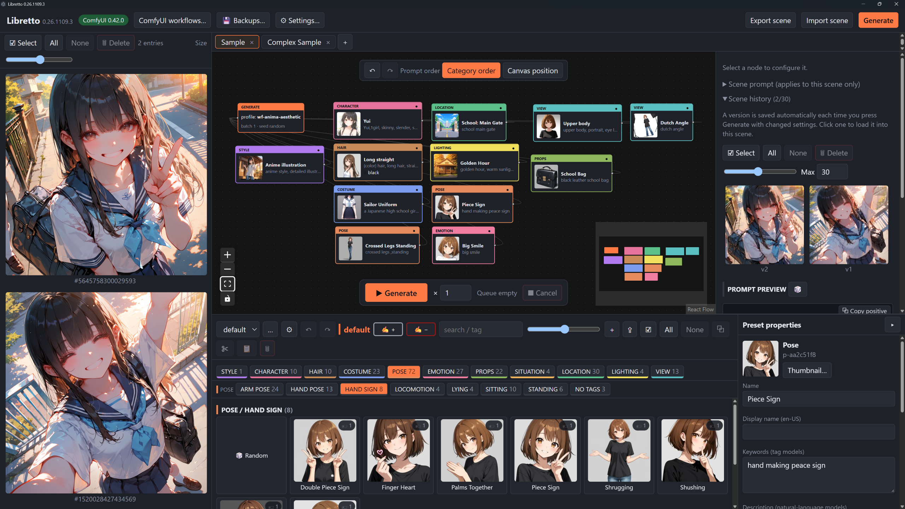
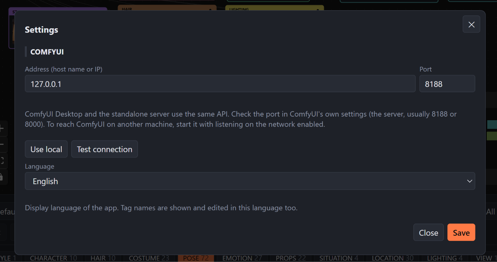
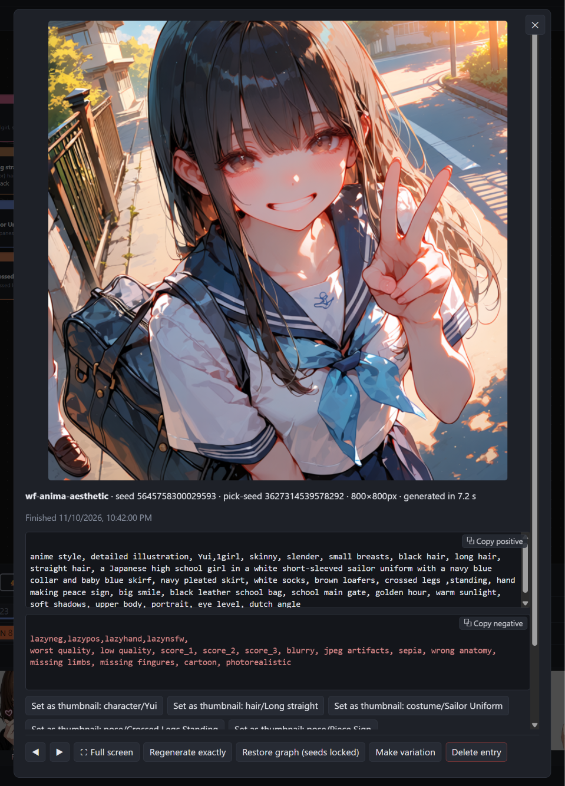

# Libretto

[日本語版はこちら](README-JP.md)

## Introduction

Libretto is a node-based **prompt generation tool** for ComfyUI. Build prompts
visually from reusable presets for characters, costumes, poses, locations,
lighting, and more, then arrange them into scenes.

**Libretto is not an image generation engine.** It composes prompts, sends them
with generation settings to a separately running ComfyUI installation, and
displays the results. ComfyUI performs the image generation using your installed
models and workflows.

## How to install

Download a desktop package from the [latest release](https://github.com/Higeneko9/Libretto/releases/latest).
The direct links below are for **v0.26.1111.0**.
You do not need to install Python or Node.js to use these packages.

| Platform | Download | Installation |
|---|---|---|
| Windows x64 | [Windows installer (.exe)](https://github.com/Higeneko9/Libretto/releases/download/v0.26.1111.0/Libretto-0.26.1111-win-x64.exe) | Run the installer, then open Libretto from the Start menu. The installer is unsigned; if SmartScreen warns, choose **More info > Run anyway** after confirming you downloaded it from this repository. |
| macOS Apple silicon | [macOS disk image (.dmg)](https://github.com/Higeneko9/Libretto/releases/download/v0.26.1111.0/Libretto-0.26.1111-mac-arm64.dmg) | Open the disk image and drag Libretto into Applications. The app is Developer ID signed and notarized. Allow Local Network access if connecting to ComfyUI on another machine. |
| Debian / Ubuntu amd64 | [Debian package (.deb)](https://github.com/Higeneko9/Libretto/releases/download/v0.26.1111.0/Libretto-0.26.1111-linux-amd64.deb) | Install with `sudo apt install ./Libretto-0.26.1111-linux-amd64.deb`, then open Libretto from the app menu. |
| Linux x86_64 | [AppImage](https://github.com/Higeneko9/Libretto/releases/download/v0.26.1111.0/Libretto-0.26.1111-linux-x86_64.AppImage) | Make the downloaded file executable and run it. Some distributions require `libfuse2`. |

Install and start [ComfyUI](https://github.com/Comfy-Org/ComfyUI) separately,
with a working text-to-image workflow and the models it needs.

Libraries, scenes, history, and settings are kept in a per-user folder across
upgrades:

| Platform | Desktop app data folder |
|---|---|
| Windows | `%APPDATA%\Libretto` |
| macOS | `~/Library/Application Support/Libretto` |
| Linux | `~/.config/Libretto` |

The Windows uninstaller asks whether to delete this data.

## How to use it

[](https://youtu.be/jTv9STxC0xk)

**YouTube walkthrough:** [English introduction](https://youtu.be/jTv9STxC0xk)
| [Japanese introduction](https://youtu.be/FM9a2HxqP0Q)

See the [UI overview](docs/UI_OVERVIEW.md) for a numbered layout diagram and
the names used throughout this guide: **Toolbar**, **Scene tabs**, **Results
browser**, **Graph editor**, **Inspector**, and **Library browser**.

### Set up the connection



The Settings dialog opens on first launch. Reopen it at any time using
**Settings** in the Toolbar.

1. Start ComfyUI and confirm it is accessible.
2. Enter its address and port. **Use local** fills in `127.0.0.1` and `8188`;
   use the port shown by your ComfyUI installation, which may be different.
3. Press **Test connection**, then **Save**.
4. Choose your display language and close the dialog.

ComfyUI Desktop and the standalone ComfyUI server expose the same API. To use
ComfyUI on another computer, enter that computer's address and ensure ComfyUI
is listening on the network and its port is allowed through the firewall.

### Choose a workflow

Open **ComfyUI workflows** from the Toolbar, select a workflow saved on your
ComfyUI server, and choose **Import & use**. Libretto converts it to API format
and registers it as a model profile.

Select the **Generate node** in the Graph editor and choose that profile in
the Inspector. Libretto fills in the compiled prompts, seed, image size,
sampler settings, and checkpoint while preserving the rest of the workflow.
Re-import the workflow after changing it in ComfyUI.

Supported workflows are KSampler-based text-to-image workflows. Subgraph-based
workflows are flattened during import; upscaler-only and 3D workflows are not
supported. If your workflow includes a prompt-enhancer switch, check its
setting in ComfyUI.

### Build a scene

A new data folder starts with the **default** library and **Sample** and
**Complex Sample** scenes. The examples use the built-in `sdxl` profile;
choose your own working profile before generating.

1. Open a scene using Scene tabs, or use **+** to create one.
2. Choose a category in the Library browser and filter by tags or search text.
3. Drag preset cards onto the Graph editor canvas. Drag several selected cards
   together to add several nodes.
4. Select a node and edit its properties in the Inspector. Select the Generate
   node to change the model profile, seed, size, sampling, and output settings.
5. Adjust scene-wide positive and negative text in the Inspector and inspect
   the Prompt preview.

Scenes autosave. Right-click a scene tab to rename, duplicate, export, close,
or delete it. Use **Export scene** and **Import scene** in the Toolbar to
exchange scene JSON files.

### Work with presets and prompts

The **Inspector** edits nodes in the current scene. **Preset properties**, on
the right of the Library browser, edits reusable library presets and autosaves
those changes. Toggle Preset properties with **N** while the pointer is over
the Library browser, or use its edge button. Editing a node does not
automatically change its source preset; save it back explicitly when needed.

Use the Library browser's management button to create, copy, import/export,
or delete libraries. Category settings let you add, rename, color, and reorder
categories. Tags can be nested, such as `dress/formal`; selecting `dress` also
matches its descendants. Ctrl-click category or tag buttons to select more
than one.

Library ZIP exports preserve the library ID, so importing a shared library
keeps scene references working when that ID is available. If it already
exists, import creates a separate library with a new ID; conflicting names
become `Library (1)`, and so on. The existing library is left unchanged.
You can then manually copy presets between libraries. Scenes are not
automatically redirected to a conflicting library's new ID. Older ZIP files
without identity metadata receive a new library ID.

For variation, drag a **Random** card onto the canvas to create a Collection
node. Collections support random/weighted, shuffle, sequential, and fixed
selection, plus tag filters. Dragging a Random card with presets selected
restricts the collection to the selected presets of that category.

Add positive or negative **Prompt nodes** for custom text. The **Prompt order
controls** at the top of the Graph editor switch between category order and
canvas position order. For multi-character scenes, use **Belongs to character**
to keep attributes with their character. The Generate node's **Between
characters** setting can separate character segments for tag-based models.

### Generate and inspect results

Use **Generate** in the Toolbar or the **Generation bar** at the bottom of the
Graph editor. The Generation bar also sets the batch count, shows queued and
running counts, and cancels runs. Generation entries appear in the Results
browser.



Open a completed result to see the **Result viewer**, including its image,
prompts, seeds, profile, and generation time. Its actions include:

- **Regenerate exactly**: re-queues the saved ComfyUI workflow.
- **Restore graph**: loads the saved graph with seeds locked.
- **Make variation**: loads the graph for another variation.
- **Set as thumbnail**: uses the image for a preset thumbnail.

Exact reproduction still depends on matching models, GPU, drivers, and
PyTorch. Snapshots record the workflow, prompts, settings, and environment to
help identify differences.

On the Generate node, **Output subfolder/prefix** controls ComfyUI's output
path relative to its output folder; `{scene}`, `{profile}`, and `{date}` are
supported. **Also copy images to local folder** keeps an additional copy on
the computer running Libretto.

### Revisit scenes and protect your work

**Scene history**, inside the Inspector, stores numbered graph versions when
you generate. An unchanged graph reuses its existing version, so several
results can share one scene version. Click a version to load it, rename it,
or pin it against automatic eviction. The per-scene **Max** setting limits
the number of versions; the default is 30.

Open **Backups** from the Toolbar to create or restore backups of libraries,
scenes, and profiles, optionally including generation history and images.
Restore merges data; **Replace all** replaces it. Both take a safety backup
first. Automatic backups run at most once a day, keeping the last 10.
Download or copy backups somewhere off the machine for protection.

Drag panel edges to resize the workspace. Shift + mouse wheel over the
Library browser, Results browser, or Scene history resizes thumbnails.
In the desktop app, Ctrl + mouse wheel or Ctrl + `+` / `-` / `0` changes
the whole UI's zoom.

## Run from source

### Requirements and structure

The commands below use PowerShell from the repository root.
CI uses **Python 3.12** and **Node.js 22**; install those along with Git and npm.
ComfyUI runs separately and needs its own environment and models.

| Directory | Role |
|---|---|
| `backend` | Python FastAPI service, prompt compilation, ComfyUI integration, and storage |
| `frontend` | React, TypeScript, Vite, React Flow, and Zustand UI |
| `desktop` | Electron shell and desktop packaging scripts |
| `profiles` | Built-in YAML model profiles and workflow templates |
| `samples` | Starter presets, thumbnails, and scenes |

### Install dependencies

```powershell
git clone https://github.com/Higeneko9/Libretto.git
Set-Location Libretto
python -m venv backend\.venv
& .\backend\.venv\Scripts\python.exe -m pip install -r backend\requirements.txt
Set-Location frontend
npm ci
Set-Location ..
```

On macOS/Linux, use your shell's equivalent commands and the virtual
environment's `bin/python` executable in place of `Scripts\python.exe`.

### Run the built UI

Build the frontend, then start the backend from the repository root:

```powershell
Set-Location frontend
npm run build
Set-Location ..
.\run.ps1
```

Open <http://127.0.0.1:8000>. The backend serves `frontend/dist` when it exists.
`run.ps1` expects `backend\.venv` and does not install dependencies or build
the frontend.

To select another ComfyUI address or Libretto port:

```powershell
.\run.ps1 -LB_ComfyUrl "http://127.0.0.1:8188" -LB_Port 8001
```

A ComfyUI URL saved through Settings takes precedence over `LB_COMFY_URL`,
including the value set by `-LB_ComfyUrl`.

### Develop with live reload

Start the backend from the repository root:

```powershell
Set-Location backend
.\.venv\Scripts\python.exe -m uvicorn libretto.main:app_factory --factory --host 127.0.0.1 --port 8000 --reload
```

In another terminal, starting from the repository root:

```powershell
Set-Location frontend
npm run dev
```

Open <http://localhost:5173>. Vite proxies `/api` requests to
`http://127.0.0.1:8000`; if you change the backend port, update the proxy in
`frontend/vite.config.ts` too.

Keep the backend bound to localhost unless you explicitly need network
access. It has no authentication; use only a trusted network, SSH tunnel,
or VPN when exposing it.

### Run the desktop shell or build an installer

After building the frontend and installing backend dependencies, run the
desktop shell from source:

```powershell
Set-Location desktop
npm ci
npm start
```

Electron starts its own backend process using `backend\.venv` when available.
Source runs use the repository's `ugc` folder by default. Set
`LB_DESKTOP_DATA` to a separate directory to isolate desktop development data.

To build a desktop package, install PyInstaller into the backend virtual
environment, then run the packaging command:

```powershell
Set-Location ..
& .\backend\.venv\Scripts\python.exe -m pip install pyinstaller
Set-Location desktop
npm run dist
```

`npm run dist` builds the frontend, bundles the backend with PyInstaller,
and creates an installer under `desktop/release`. Use `npm run pack` for
an unpacked app. Build on the target operating system; macOS distribution
also requires signing and notarization credentials. The **Build installers**
GitHub Actions workflow provides the cross-platform build matrix.

### Configuration and storage

Source-run data lives under the git-ignored `ugc` directory by default.
Libraries contain YAML presets and thumbnails; scenes are JSON graphs;
generation history uses SQLite with per-run snapshot directories.

| Variable | Default | Purpose |
|---|---|---|
| `LB_COMFY_URL` | `http://127.0.0.1:8188` | ComfyUI URL when no URL is saved in Settings |
| `LB_UGC_ROOT` | `ugc` | Parent of user-generated content and `settings.json` |
| `LB_LIBRARIES_ROOT` | `ugc/libraries` | Presets and thumbnails, one folder per library |
| `LB_SCENES_ROOT` | `ugc/scenes` | Saved scene graphs |
| `LB_PROFILES_ROOT` | `profiles` | Built-in profiles and workflow templates |
| `LB_USER_PROFILES_ROOT` | `ugc/profiles` | Imported and edited profiles |
| `LB_DATA_ROOT` | `ugc/data` | SQLite history, snapshots, and collection state |
| `LB_BACKUP_ROOT` | `backups` | Backup archives; defaults beside the UGC root |
| `LB_AUTO_BACKUP` | `1` | Set to `0` to disable automatic backups |
| `LB_SCENE_SNAP_MAX` | `30` | Default maximum graph versions per scene |
| `LB_MODELS_ROOT` | unset | ComfyUI models directory; enables model SHA256 hashes in snapshots |

When `LB_UGC_ROOT` changes, its default child paths change with it unless
individually overridden. Scene versions are stored under
`ugc/data/scene_snaps`; generation snapshots under `ugc/data/snapshots`.
User content is not protected by Git: use Backups before experimenting.

To add a built-in model profile, use `profiles/sdxl.yaml` as a starting point.
Set its prompt format (`tags` or `natural`), defaults, quality prefix,
negative template, and `workflow_template`. The template must be a ComfyUI
API-format workflow; `injection` maps parameters to its node IDs.

### Checks

Run backend tests from the repository root:

```powershell
Set-Location backend
.\.venv\Scripts\python.exe -m pytest -q
```

Run frontend checks from a separate terminal at the repository root:

```powershell
Set-Location frontend
npm run typecheck
npm test
npm run build
```

## License information

Libretto is released under the [MIT License](LICENSE).
Copyright (c) 2026 Higeneko9. It is provided without warranty.

ComfyUI, models, and other dependencies have their own licenses; check their
terms separately.
