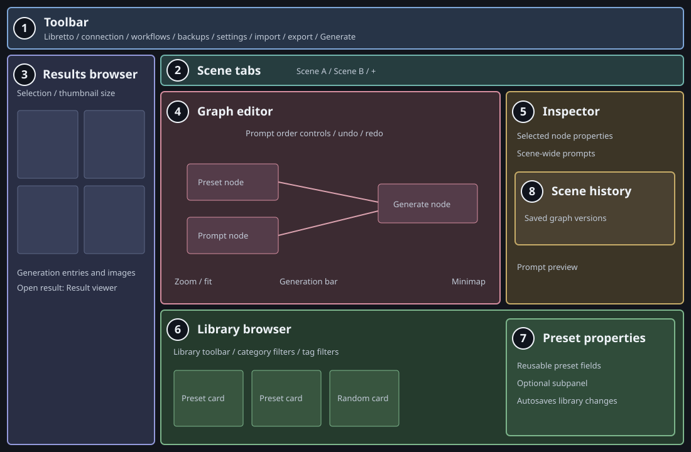
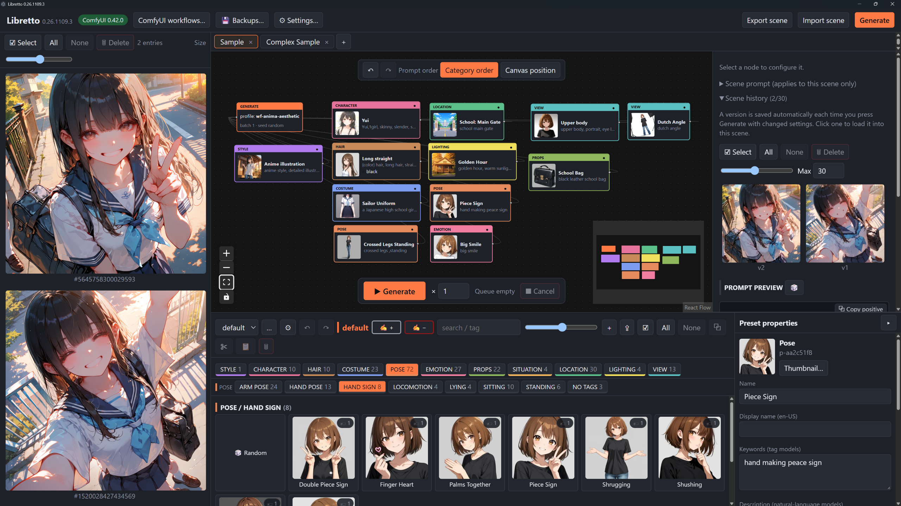
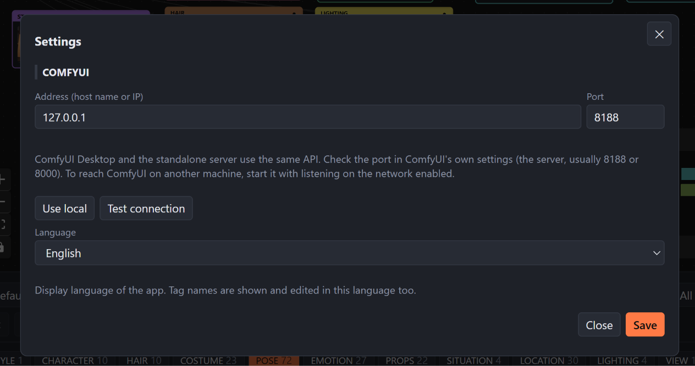
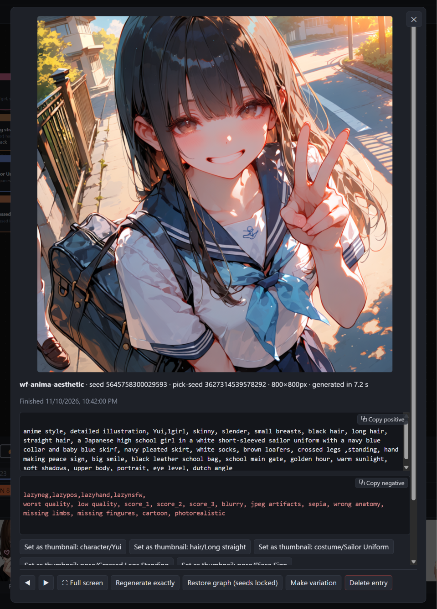

# Libretto UI overview

Use the names below consistently in documentation, issue reports, and discussions
about the interface. These names describe the existing UI; they do not introduce
new controls.

*Layout schematic, not a screenshot. Panel sizes vary, and Preset properties can
be hidden. The numbers identify areas in this guide, not controls in the app.*

## Main areas

| No. | Name | Location | Purpose |
|---|---|---|---|
| 1 | **Toolbar** | Across the top | Shows the app version and connection status; opens ComfyUI workflows, Backups, and Settings; imports/exports scenes and starts generation. |
| 2 | **Scene tabs** | Above the Graph editor and Inspector | Switches between scenes. The **+** button creates, imports, or reopens scenes; a tab's context menu includes rename, duplicate, export, close, and delete. |
| 3 | **Results browser** | Left side, below the Toolbar | Displays generation entries, including queued/running runs and completed images. Select and delete entries, resize thumbnails, or open a result for a larger view and reproduction actions. |
| 4 | **Graph editor** | Center | Arranges and connects the active scene's nodes. Drag presets from the Library browser here and select nodes to edit their properties in the Inspector. |
| 5 | **Inspector** | Right of the Graph editor | Edits selected node properties and scene-wide prompts. Also contains Scene history and the Prompt preview. Selecting the Generate node exposes its generation and output settings here. |
| 6 | **Library browser** | Below the Graph editor and Inspector | Switches and manages libraries, filters presets by category, tags, or search text, and supplies preset, Collection, and Prompt nodes for the Graph editor. |

## Nested areas and controls

| No. | Name | Parent area | Purpose |
|---|---|---|---|
| 7 | **Preset properties** | Library browser, right side | Edits the selected reusable library preset or presets and autosaves changes. Toggle with **N** while the pointer is over the Library browser, or with the edge button. |
| 8 | **Scene history** | Inspector | Lists saved graph versions for the active scene. Load a version, name it, pin it against automatic eviction, or remove versions. |
| - | **Prompt preview** | Inspector | Shows the compiled positive and negative prompts. |
| - | **Prompt order controls** | Top of the Graph editor | Switches between category order and canvas position order. Undo and redo buttons sit alongside these controls. |
| - | **Generation bar** | Bottom of the Graph editor | Starts generation, sets the batch count, shows running/queued counts, and cancels runs. |
| - | **Canvas navigation controls** | Lower corners of the Graph editor | Provides zoom/fit controls and a minimap for navigating the graph. |
| - | **Library toolbar** | Top of the Library browser | Contains the library selector, management actions, search, thumbnail sizing, and preset actions. Category and tag filter rows appear below it. |
| - | **Panel splitters** | Resizable panel edges | Changes the Results browser width, Inspector width, Library browser height, or Preset properties width. |

## Naming conventions

Use **Graph editor** for the whole central area and **canvas** for its pannable,
zoomable surface. A **node** is an item on that canvas; the **Generate node** is
the node that holds generation settings, not the Generation bar.

Use **Library browser** rather than alternating between "palette" and "library
panel." A **library** is the collection of reusable presets, while a **preset
card** is one of its visible items.

Right-click a preset card and choose **Duplicate** to copy it within the active
library. If the card is part of a multi-selection, all selected presets are
duplicated. Duplicate leaves the copy/cut clipboard unchanged. Preset copies
receive fresh `p-xxxxxxxx` IDs and filenames, including when pasted into another
library; display-name collisions still receive a numbered suffix such as
`Name (1)`. Generic and profile-specific thumbnails are copied too.

Library ZIP exports include the library ID. Import keeps that ID when it is
available, so scenes shared with the library retain their references. If the ID
already exists, import creates a separate library with a fresh ID rather than
overwriting or merging the existing one. Conflicting library names receive a
numbered suffix such as `Library (1)`. Preset and tag IDs inside the archive stay
unchanged. You can manually copy presets between the libraries afterward.

When an ID conflict creates a separate library, shared scenes still reference
the original ID; their references are not automatically redirected to the new
copy. This also applies to the built-in `default` library, which normally
already exists. Older ZIP exports without identity metadata still import, but
receive a new library ID because their original ID is unknown.

Keep **Inspector** and **Preset properties** distinct: the Inspector edits node
instances in the active scene; Preset properties edits reusable library data.
Changing a node does not by itself update its source preset; nodes can be saved
back to the library explicitly.

Keep **Results browser** and **Scene history** distinct: results represent
generation runs and their images; scene history represents saved graph versions.
Several generations can reuse the same scene version. Use **Result viewer** for
the larger image dialog opened from the Results browser.

Use the full area name in instructions, for example:

- "Drag a preset card from the Library browser onto the Graph editor canvas."
- "Select the Generate node, then change its output settings in the Inspector."
- "Open Preset properties to edit the reusable preset."
- "Choose a version in Scene history, then inspect its linked output in the Results browser."

## Screenshots

These screenshots show Libretto 0.26.1109.3 in English. Use the numbered
schematic above to locate the named areas; panel sizes and visible content can
differ in your workspace.

### Main workspace

The Inspector shows Scene history and Prompt preview. In the Library browser,
the Pose category and Hand Sign tag are selected, and Preset properties shows
the Peace Sign preset. The Generation bar sits near the bottom of the Graph
editor.

### Settings dialog

Open **Settings** from the Toolbar to configure the ComfyUI connection and
display language. The dialog overlays the workspace; it is not a permanent
panel.

### Result viewer

Open a completed result in the Results browser to see the Result viewer. It
shows the image, profile, seeds, image size, generation time, and prompts.
Actions let you set preset thumbnails, view the image full screen, reproduce
the run, restore its graph, or make a variation.

## Implementation references

For contributors, these user-facing names map to the following source files:

| UI name | Implementation |
|---|---|
| Toolbar, Graph editor, Prompt order controls, Generation bar | `frontend/src/App.tsx`: `Toolbar`, `Canvas`, `OrderToggle`, `GenerateBar` |
| Scene tabs | `frontend/src/SceneTabs.tsx` |
| Results browser and Result viewer | `frontend/src/Results.tsx` |
| Inspector and Prompt preview | `frontend/src/Inspector.tsx` |
| Library browser | `frontend/src/Palette.tsx` |
| Preset properties | `frontend/src/PresetPane.tsx` |
| Scene history | `frontend/src/SceneHistory.tsx` |
| Panel splitters | `frontend/src/Splitter.tsx` |

The overall placement is defined by `.app`'s grid in
`frontend/src/styles.css`.
